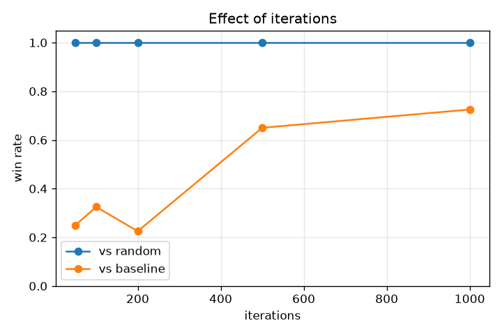
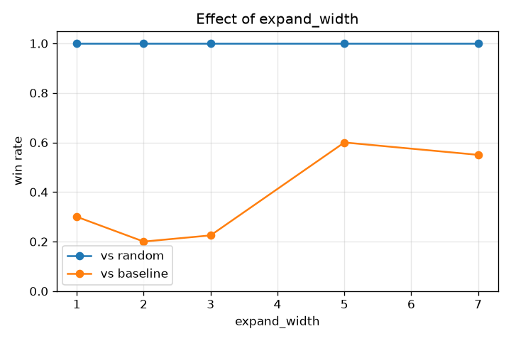
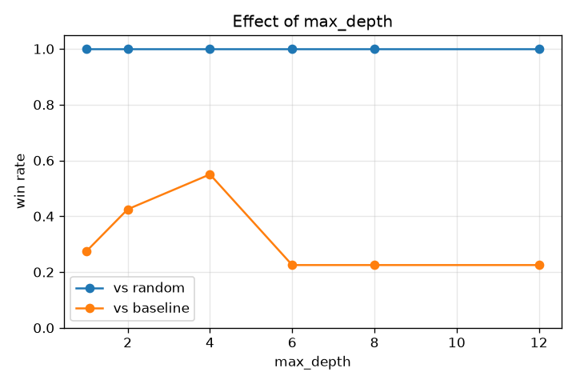
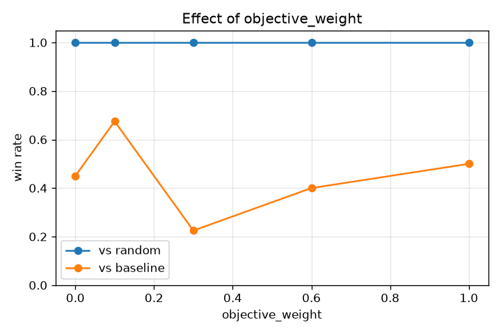
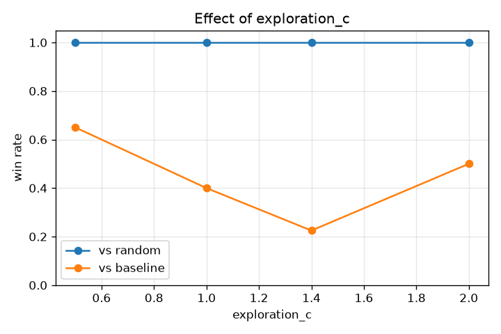
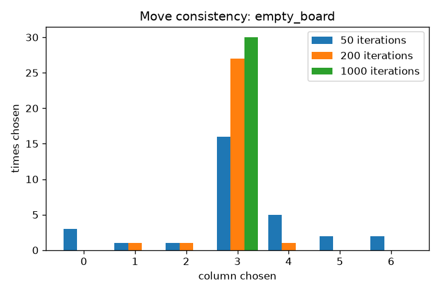
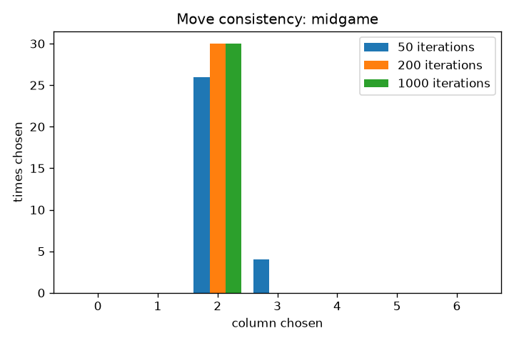
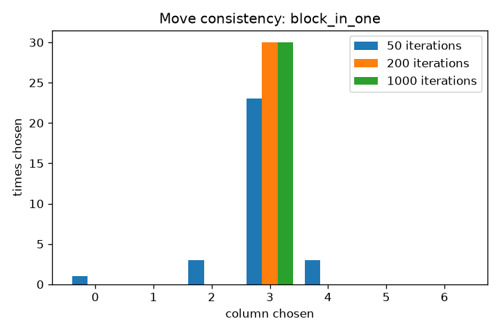

# Connect Four Monte Carlo Tree Search: Report

## 1. Design

The move generator is in `q1_connect4/mcts.py` and follows Figure 5.11 of the text. The rules of the game are in `board.py`. Each call builds a fresh tree from the current position and repeats SELECT, EXPAND, SIMULATE and BACK-PROPAGATE a configurable number of times (`iterations`). The move returned is the root child with the most playouts.

**Node statistics.** Every node stores `visits` (N) and `wins` (U). A win counts 1, a draw 0.5 and a loss 0, always from the point of view of the player who just moved into that node. That way a parent can choose the child that is best for the player who is choosing.

**SELECT (utility function).** Starting at the root, the search keeps moving to the child with the highest utility until it reaches a node that still has untried moves, a finished game, or a node at the maximum depth.

    utility = wins/visits + C * sqrt(ln(parent visits) / visits) + objective_weight * objective

- The first two terms are the *playout part*. The win rate is built from stored playout results, and the second term (UCB1) rewards children that have been tried only a few times.
- The last term is the *objective part*, which comes from the rules of the game and not from playouts. `objective()` looks at all 69 groups of four cells that could make a line. A group with no opponent pieces scores +5 if it holds three of our pieces and +2 if it holds two. A group with none of our pieces scores -5 if the opponent holds three and -2 if they hold two. Each piece in the centre column adds or removes 3 points, because centre pieces take part in the most lines. The total is squashed with tanh(score / 20) so it lies between -1 and 1, on a similar scale to a win rate. A finished game scores +1, -1 or 0.

**EXPAND.** When a node is reached, up to `expand_width` of its untried moves are turned into children. They are chosen by the objective score, best first, with random tie-breaking. Untried moves stay available, so the next time selection reaches the node another group is added. Over several iterations every column of the root is eventually considered, even when `expand_width` is 1.

**Tree height.** The tree is limited to `max_depth`. A node at that depth is not expanded; a random playout is simulated from it instead.

**SIMULATE.** From a new child, both players choose random legal moves until someone wins or the board is full. The result (player 1, player 2 or draw) is returned. Every new child gets its own playout, so the number of playouts is at least the number of iterations.

**BACK-PROPAGATE.** The result is added to the visits and wins of the child and every ancestor up to the root.

**Choosing the move.** The root child with the most visits is chosen. Ties go to the higher win rate and then to the lower column number. Visits are used instead of win rate because a child with one visit and one win would otherwise look perfect.

**Randomness.** The whole search uses one `random.Random(seed)`. The same seed on the same position always gives the same tree and the same move. Without a seed, results differ from run to run.

**Tests.** `pytest` runs 35 tests: the board rules (all four directions of winning, gravity, copying), the search steps, and positions stored in `q1_connect4/test_data/` (taking a win in one move, blocking a loss in one move, a nearly full board with one legal move). They also run automatically on GitHub Actions.

## 2. Experiment setup

- **Baseline settings:** iterations 200, expand_width 3, max_depth 6, exploration_c 1.4, objective_weight 0.3.
- **Strength experiments (sweeps).** Each sweep changes one setting and keeps the others at the baseline. The variant plays 20 games against (a) a random player and (b) the baseline MCTS player, and the two players alternate who moves first, because the first player has an advantage. Win rate = (wins + 0.5 x draws) / games. A master seed of 2026 makes every run reproducible.
- **Consistency experiment.** For three positions (the empty board, a midgame position, and a position where the player to move must block an immediate loss) and three iteration levels (50, 200, 1000), the search is run 30 times with seeds 0 to 29 and the chosen column is counted.
- **Noise check.** The baseline plays itself for 20 games under each of six different master seeds (11 to 16). The true win rate is 0.5, so this shows how far a 20-game result can wander by chance.
- **Depth check.** Searches with no depth cap show how deep the tree really grows (`depth.csv`).
- **Reproducing:** the win, draw and loss counts depend only on the code and the seeds, so they reproduce exactly on any computer with the same Python. The seconds-per-move numbers depend on the computer.

      python q1_connect4/experiments.py sweeps --games 20
      python q1_connect4/experiments.py consistency --runs 30
      python q1_connect4/experiments.py noise --games 20
      python q1_connect4/experiments.py depth
      python q1_connect4/experiments.py charts

- **Timings in this report were measured on:** Python 3.14.2

## 3. Results

### 3.1 How much noise is there?

Playing the baseline against itself should give 0.5. The sweeps contain one such row each (the value equal to the baseline), and in all five sweeps that row is the same game sequence: 4 wins, 1 draw, 15 losses, a win rate of 0.225. Six other master seeds give:

| Master seed | W-D-L | Win rate |
|---|---|---|
| 11 | 13-0-7 | 0.65 |
| 12 | 7-1-12 | 0.375 |
| 13 | 11-0-9 | 0.55 |
| 14 | 8-0-12 | 0.4 |
| 15 | 9-1-10 | 0.475 |
| 16 | 9-0-11 | 0.45 |

Pooled over 120 games the win rate is 0.483, so the match code is not biased. Single 20-game results ranged from 0.375 to 0.65 and the seed-2026 baseline row (0.225) was simply an unlucky sample. The standard error of one 20-game win rate is about 0.11, so **differences of less than about 0.2 cannot be trusted**.

### 3.2 Strength against a random player

Every one of the 25 settings won all 20 games against the random player (win rate 1.0), even 50 iterations and a tree of height 1. The random player is therefore too weak to tell the settings apart, and the comparisons below use the baseline MCTS as the opponent. The result does show that the search plays sensibly.

In the tables, "sec per move" is the average time per move in the games against the random player.

### 3.3 Iterations

| Iterations | vs random (W-D-L) | vs baseline (W-D-L) | Win rate vs baseline | Sec per move |
|---|---|---|---|---|
| 50 | 20-0-0 | 5-0-15 | 0.25 | 0.0119 |
| 100 | 20-0-0 | 6-1-13 | 0.325 | 0.0242 |
| 200 | 20-0-0 | 4-1-15 | 0.225 | 0.0479 |
| 500 | 20-0-0 | 12-2-6 | 0.65 | 0.135 |
| 1000 | 20-0-0 | 14-1-5 | 0.725 | 0.2438 |

### 3.4 Expansion width

| Expand width | vs random (W-D-L) | vs baseline (W-D-L) | Win rate vs baseline | Sec per move |
|---|---|---|---|---|
| 1 | 20-0-0 | 6-0-14 | 0.3 | 0.0373 |
| 2 | 20-0-0 | 4-0-16 | 0.2 | 0.0424 |
| 3 | 20-0-0 | 4-1-15 | 0.225 | 0.0508 |
| 5 | 20-0-0 | 11-2-7 | 0.6 | 0.0667 |
| 7 | 20-0-0 | 11-0-9 | 0.55 | 0.0971 |

### 3.5 Tree height

| Max depth | vs random (W-D-L) | vs baseline (W-D-L) | Win rate vs baseline | Sec per move |
|---|---|---|---|---|
| 1 | 20-0-0 | 5-1-14 | 0.275 | 0.0105 |
| 2 | 20-0-0 | 8-1-11 | 0.425 | 0.0135 |
| 4 | 20-0-0 | 11-0-9 | 0.55 | 0.0521 |
| 6 | 20-0-0 | 4-1-15 | 0.225 | 0.0507 |
| 8 | 20-0-0 | 4-1-15 | 0.225 | 0.0528 |
| 12 | 20-0-0 | 4-1-15 | 0.225 | 0.0554 |

Deepest node reached with no depth cap (`depth.csv`, 5 seeds per row):

| Position | Iterations | Deepest node |
|---|---|---|
| empty board | 50 | 3-4 |
| empty board | 200 | 4 |
| empty board | 1000 | 6 |
| midgame | 50 | 3 |
| midgame | 200 | 4-5 |
| midgame | 1000 | 6 |

### 3.6 Utility function

| Objective weight | vs random (W-D-L) | vs baseline (W-D-L) | Win rate vs baseline | Sec per move |
|---|---|---|---|---|
| 0.0 | 20-0-0 | 8-2-10 | 0.45 | 0.0528 |
| 0.1 | 20-0-0 | 13-1-6 | 0.675 | 0.0499 |
| 0.3 | 20-0-0 | 4-1-15 | 0.225 | 0.049 |
| 0.6 | 20-0-0 | 8-0-12 | 0.4 | 0.0542 |
| 1.0 | 20-0-0 | 10-0-10 | 0.5 | 0.0512 |

| Exploration C | vs random (W-D-L) | vs baseline (W-D-L) | Win rate vs baseline | Sec per move |
|---|---|---|---|---|
| 0.5 | 20-0-0 | 13-0-7 | 0.65 | 0.0459 |
| 1.0 | 20-0-0 | 7-2-11 | 0.4 | 0.0485 |
| 1.4 | 20-0-0 | 4-1-15 | 0.225 | 0.0493 |
| 2.0 | 20-0-0 | 10-0-10 | 0.5 | 0.0483 |

### 3.7 Does it always choose the same move?

Counts of the column chosen in 30 searches (seeds 0 to 29):

| Position | Iterations | col0 | col1 | col2 | col3 | col4 | col5 | col6 | Most common | Share | Distinct moves |
|---|---|---|---|---|---|---|---|---|---|---|---|
| empty_board | 50 | 3 | 1 | 1 | 16 | 5 | 2 | 2 | 3 | 0.53 | 7 |
| empty_board | 200 | 0 | 1 | 1 | 27 | 1 | 0 | 0 | 3 | 0.9 | 4 |
| empty_board | 1000 | 0 | 0 | 0 | 30 | 0 | 0 | 0 | 3 | 1.0 | 1 |
| midgame | 50 | 0 | 0 | 26 | 4 | 0 | 0 | 0 | 2 | 0.87 | 2 |
| midgame | 200 | 0 | 0 | 30 | 0 | 0 | 0 | 0 | 2 | 1.0 | 1 |
| midgame | 1000 | 0 | 0 | 30 | 0 | 0 | 0 | 0 | 2 | 1.0 | 1 |
| block_in_one | 50 | 1 | 0 | 3 | 23 | 3 | 0 | 0 | 3 | 0.77 | 4 |
| block_in_one | 200 | 0 | 0 | 0 | 30 | 0 | 0 | 0 | 3 | 1.0 | 1 |
| block_in_one | 1000 | 0 | 0 | 0 | 30 | 0 | 0 | 0 | 3 | 1.0 | 1 |

## 4. Analysis

**Iterations.** The time per move grows in direct proportion to the iterations: 0.012 s at 50 iterations and 0.244 s at 1000, about 20 times more for 20 times the iterations. Strength against the baseline rose with iterations. The two smallest settings scored 0.25 and 0.325, 500 iterations scored 0.65 and 1000 iterations scored 0.725 (14 wins, 1 draw, 5 losses). The 1000-iteration result is the one clearly above the noise band: if the two players were equal, 14 or more wins out of 19 decisive games would happen about 3% of the time. The 500-iteration result (12 wins, 6 losses) could still be chance, with about a 12% probability. More iterations help because every node's win rate rests on more playouts, so it is less affected by lucky or unlucky random games. The cost is time, and the gain probably flattens out as the estimates get more accurate.

**Expansion width.** Widths 5 and 7 scored 0.6 and 0.55 against the baseline, while widths 1, 2 and 3 scored 0.3, 0.2 and 0.225. The time per move rose from 0.037 s to 0.097 s. Two things change together here. A wider expansion lets each iteration look at more moves, and because every new child gets its own playout it also runs more playouts per iteration, which is the reason it costs more time. So with this design I cannot say how much of the improvement comes from width itself and how much from the extra playouts. With a width of 1 the root only adds one new move per iteration, so early iterations explore very little.

**Tree height.** A height of 1 (no lookahead below the root) scored 0.275, a height of 2 scored 0.425 and a height of 4 scored 0.55. Heights 6, 8 and 12 gave exactly the same result as the baseline (0.225) and about the same time per move. This is because the tree never gets that deep with 200 iterations: the depth check found the deepest node at depth 3 to 4 with 50 iterations, 4 to 5 with 200 iterations and 6 with 1000 iterations. The cap does nothing when the tree does not reach it. So the height only matters in combination with the number of iterations. A very low height removes the lookahead, so threats a few moves ahead are only seen through random playouts. Whether capping at 4 is better than the baseline's 6 cannot be decided from 20 games.

**Utility function.** The objective weights 0, 0.1, 0.3, 0.6 and 1.0 scored 0.45, 0.675, 0.225, 0.4 and 0.5, and exploration constants 0.5, 1.0, 1.4 and 2.0 scored 0.65, 0.4, 0.225 and 0.5. Neither list shows a steady trend, and the spread is about the size of the noise in 3.1. Within the range I tested, I cannot show that either the rules-based part or the exploration constant matters for strength. What the objective does is decide which children are expanded first, which is why it helps to find forced moves quickly. I did not run the experiment that would show that directly (for example, the block test with weight 0).

**Overall.** With only 20 games per setting and 25 comparisons, a few settings are expected to look good by chance. The only result I treat as solid is that 1000 iterations beat the baseline. A tree height of 1 scored 0.275, but the baseline itself scored 0.225 on the same games, so that sweep cannot show that height 1 is worse. Everything else is suggestive. More games per setting, or repeating each experiment with several master seeds, would be the way to get firmer conclusions.

## 5. Does the simulator always generate the same move?

**No, not always, and how often it varies depends on the position and the number of iterations.**

- On the **empty board** with 50 iterations, the search chose column 3 in 16 of 30 runs (53%), and all 7 columns appeared at least once. With 200 iterations column 3 was chosen 27 times (90%, 4 different moves), and with 1000 iterations it was chosen all 30 times.
- In the **midgame position** the same move (column 2) was chosen in 26 of 30 runs with 50 iterations (87%, 2 different moves) and in all 30 runs with 200 and 1000 iterations.
- In the **block-in-one position**, where one column must be played to stop an immediate loss, 50 iterations found column 3 in only 23 of 30 runs (77%) and missed it 7 times, while 200 and 1000 iterations found it every time.

**What causes the differences:**
- The playouts are random, so the win rates in the tree are noisy estimates. With few iterations each move is estimated from only a handful of playouts, and the move with the most visits can change from run to run.
- Random numbers are also used to break ties between moves with equal scores, such as the six non-centre columns on the empty board.
- The seed controls all of this. The same seed always gives the same tree and the same move (one of the tests checks this), while different seeds give different trees.

**What causes the similarities:**
- Strong positions: when one move is clearly best, such as a block, the search finds it in every run once there are enough iterations.
- The centre column gets a bonus from the objective, which pulls the empty board towards column 3.
- More iterations average out the randomness, so the most-visited move becomes more stable. By 1000 iterations all three positions gave the same move in 30 of 30 runs.

## 6. Reflection

- **Limitations.** Each setting was tested with only 20 games, and the noise check shows a single 20-game result can be off by 0.2 or more. Random players are too weak to rank settings, and I used only one baseline as a stronger opponent. The objective function ignores gravity (a three-in-a-row may not be playable yet) and does not recognise an immediate win by itself. The playouts are completely random. Python is slow, which limited how many games and iterations I could run.
- **What I would try next.** Run more games with several master seeds and report an average. Make the playouts smarter (take an immediate win and avoid giving one away). Reuse the part of the tree that is still valid after each move. Test a stronger opponent than the random player, for example a depth-limited minimax. Run an experiment that separates width from the number of playouts, and one that tests the objective weight on a position that needs the objective to find the right move.